# 课程管理插件 - 教师使用指南

## 目录

1. [班级管理](#班级管理)
2. [课程模板管理](#课程模板管理)
3. [课程管理](#课程管理)
4. [章节与DAG配置](#章节与dag配置)
5. [讲义管理](#讲义管理)
6. [成绩管理](#成绩管理)
7. [常见问题](#常见问题)

---

## 班级管理

### 1.1 进入班级管理页面

**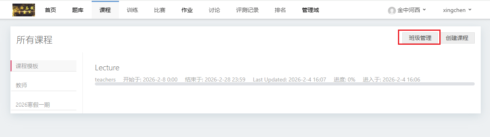**
**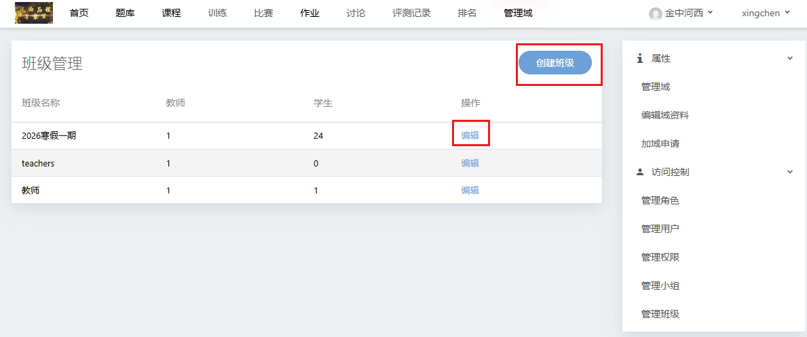**

1. 登录系统后，点击顶部导航栏的【课程】
2. 点击按钮【班级管理】
3. 进入班级列表页面，可以看到当前域下的所有班级

### 1.2 创建新班级

**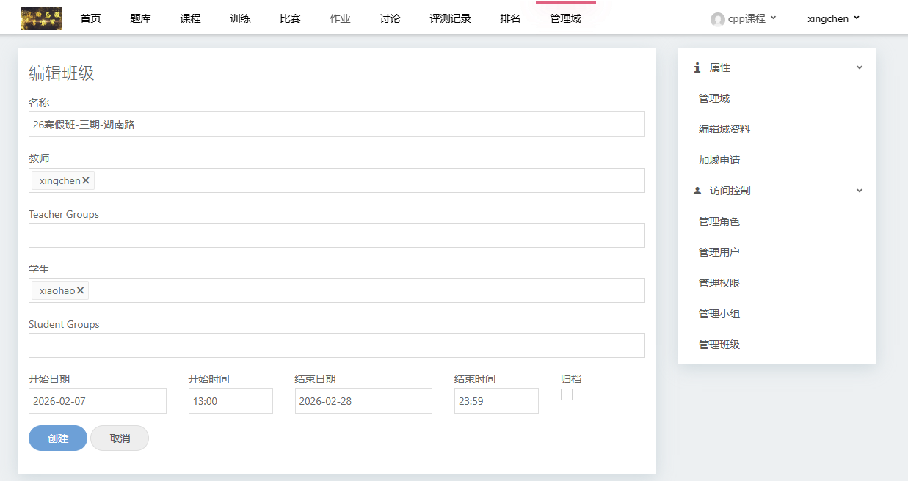**

1. 点击【创建班级】按钮
2. 填写班级信息：
   - **班级名称**：输入班级名称（如"2024春季高一班"）
   - **教师**：点击教师输入框，搜索并选择教师用户（可多选）
   - **学生**：点击学生输入框，搜索并选择学生用户（可多选）
   - **开始日期/时间**：设置班级开始时间
   - **结束日期/时间**：设置班级结束时间
   - **归档**：如需暂时隐藏该班级，可勾选归档
3. 点击【创建】按钮完成

### 1.3 编辑班级

**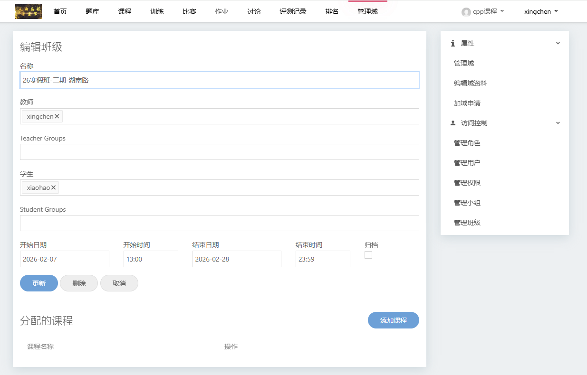**

1. 在班级列表中找到需要编辑的班级
2. 点击班级名称或【编辑】链接
3. 修改需要调整的字段：
   - 可添加/删除教师和学生
   - 可修改时间范围
   - 可修改归档状态
4. 点击【更新】保存

**注意**：修改班级时间会自动同步更新该班级下所有课程的时间。

### 1.4 从模板复制课程到班级

**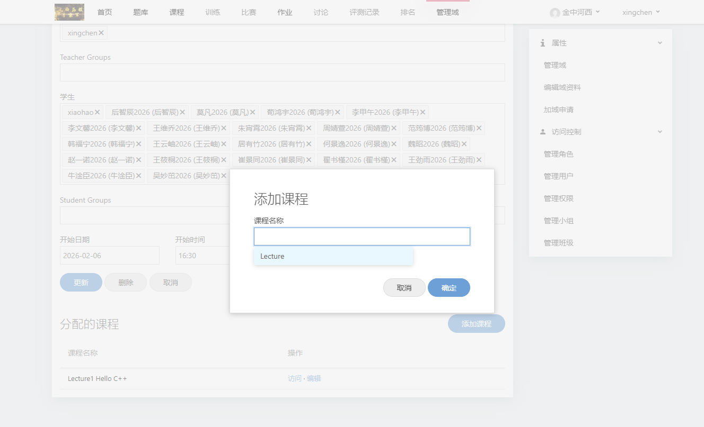**
**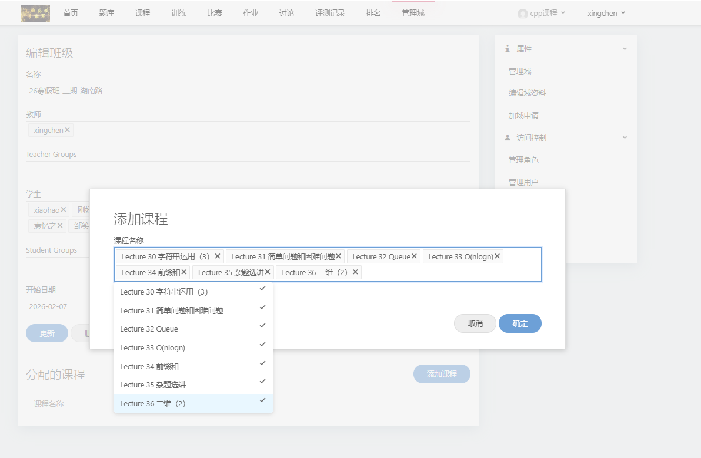**

1. 进入班级编辑页面
2. 在"分配的课程"区域点击【添加课程】
3. 在弹出的对话框中选择要复制的课程模板
4. 点击【确定】
5. 系统会自动：
   - 复制课程结构和题目
   - 复制讲义内容
   - 复制相关文件
   - 将新课程分配给当前班级

---

## 课程模板管理

### 2.1 创建课程模板

**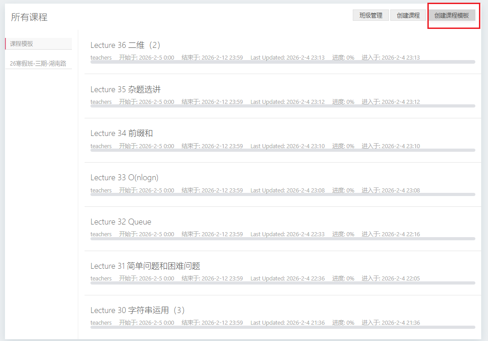**

课程模板是一种特殊的课程，用于快速复制到多个班级。

**创建方式：**

1. 进入【课程】页面
2. 点击右上角的【创建课程模板】按钮
3. 填写模板信息：
   - **课程标题**：模板的名称（页面标题会显示【模板】标识）
   - **课程内容**：课程说明
   - **分配给班级**：可输入分类名称如"高一物理"、"Python入门"等（用于模板分类，实际自动分配给"TEACHERS"班级）
4. 配置DAG章节结构（详见[章节与DAG配置](#章节与dag配置)）
5. 点击【创建】

**模板特点**：
- 模板自动分配给"TEACHERS"班级
- 创建时隐藏开始/结束时间设置
- 学生无法直接看到模板，只有教师可以查看和使用
- 编辑现有课程时也可点击【存为模板】按钮将其转为模板

### 2.2 管理课程模板

**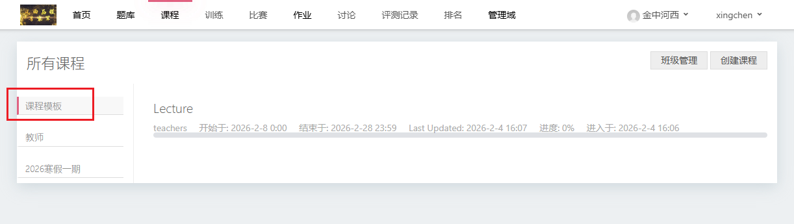**
**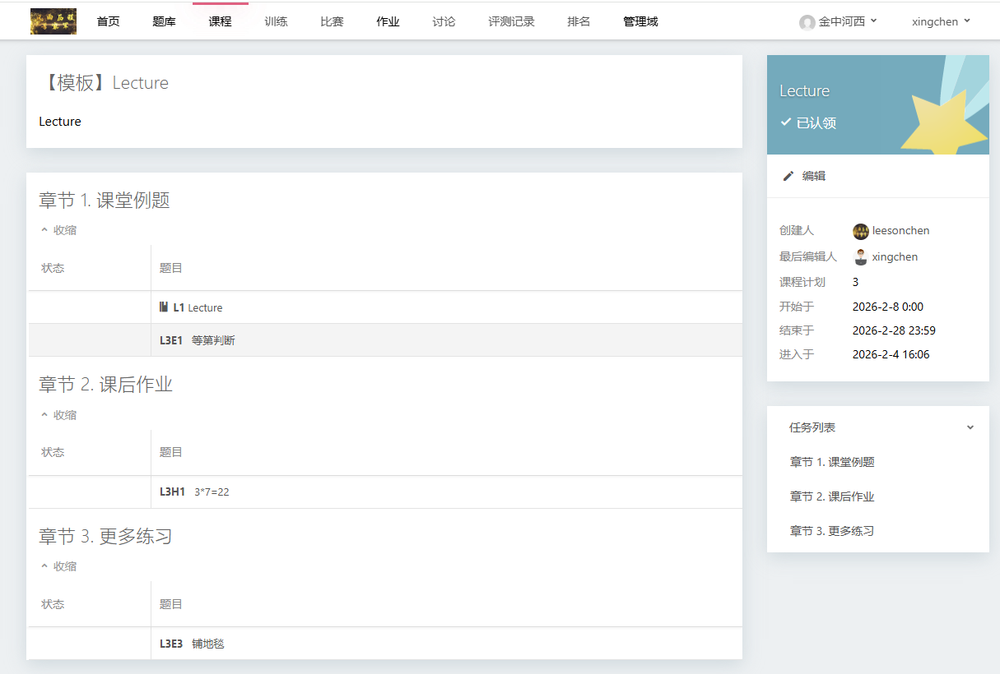**

1. 进入课程列表页面
2. 点击左侧“课程模板”查看所有的模板列表
3. 点击模板标题可以查看模板内容
4. 编辑模板不会影响已复制到班级的课程

---

## 课程管理

### 3.1 创建普通课程

**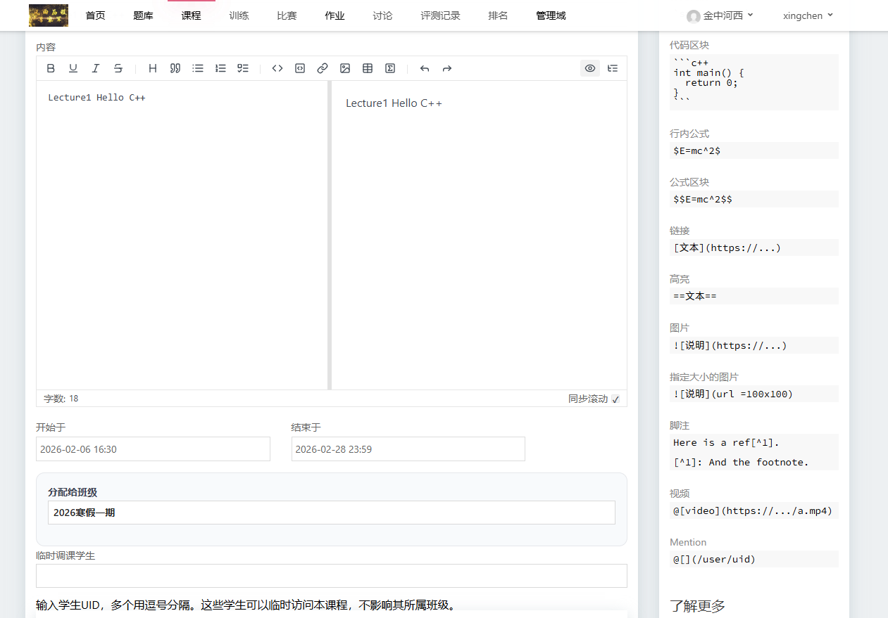**

1. 进入【课程】页面，点击【创建课程】
2. 填写课程信息：
   - **课程标题**：课程名称
   - **课程内容**：课程描述
   - **开始时间**：课程开始时间
   - **结束时间**：课程结束时间
   - **分配给班级**：选择要分配的班级（只能选未归档的班级）
   - **临时调课学生**：可添加其他非班级学生临时使用
3. 编辑课程计划和章节结构（详见[章节与DAG配置](#章节与dag配置)）
4. 点击【创建】

### 3.2 编辑课程基本信息

1. 进入课程详情页
2. 点击【编辑】按钮
3. 可以修改：
   - 标题和内容
   - 分配的班级
   - 时间范围
   - 临时调课学生
   - 课程计划和章节结构

### 3.3 删除课程

> ⚠️ **警告**：删除课程会同时删除所有相关数据，包括学生成绩！

1. 进入课程编辑页面
2. 点击【删除】按钮
3. 确认删除操作

---

## 章节与DAG配置

### 4.1 理解DAG结构

**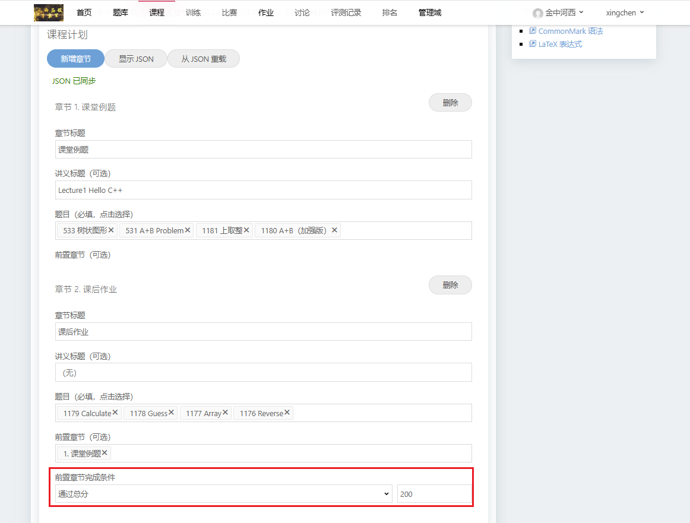**

课程使用DAG（有向无环图）来组织章节，支持章节间的依赖关系。

**基本概念**：
- **章节（Node）**：课程的一个单元，包含题目和讲义
- **章节ID（_id）**：章节的唯一标识符（数字）
- **前置条件（requireNids）**：完成本章节需要先完成的其他章节ID列表
- **完成条件（completeCondition）**：判定章节完成的规则

### 4.2 DAG JSON格式

```json
[
  {
    "_id": 1,
    "title": "第一章：基础概念",
    "lecture": true,
    "pids": [1001, 1002, 1003],
    "completeCondition": {"type": "all"}
  },
  {
    "_id": 2,
    "title": "第二章：进阶应用",
    "lecture": true,
    "pids": [1004, 1005],
    "requireNids": [1],
    "completeCondition": {"type": "problem", "value": 1}
  },
  {
    "_id": 3,
    "title": "第三章：综合实践",
    "lecture": true,
    "pids": [1006, 1007, 1008, 1009],
    "requireNids": [1, 2],
    "completeCondition": {"type": "score", "value": 200}
  }
]
```

### 4.3 字段说明

| 字段 | 类型 | 必填 | 说明 |
|------|------|------|------|
| `_id` | number | 是 | 章节唯一ID，从1开始递增 |
| `title` | string | 是 | 章节标题 |
| `lecture` | boolean/string | 否 | 是否有讲义（true/false或讲义内容） |
| `pids` | number[] | 是 | 章节包含的题目ID列表 |
| `requireNids` | number[] | 否 | 前置章节ID列表 |
| `completeCondition` | object | 否 | 完成条件，默认`{type: "all"}` |

### 4.4 完成条件类型

| 类型 | 格式 | 说明 |
|------|------|------|
| `all` | `{"type": "all"}` | 完成所有题目 |
| `problem` | `{"type": "problem", "value": 3}` | 完成指定数量的题目 |
| `score` | `{"type": "score", "value": 100}` | 达到指定总分 |

### 4.5 配置步骤

**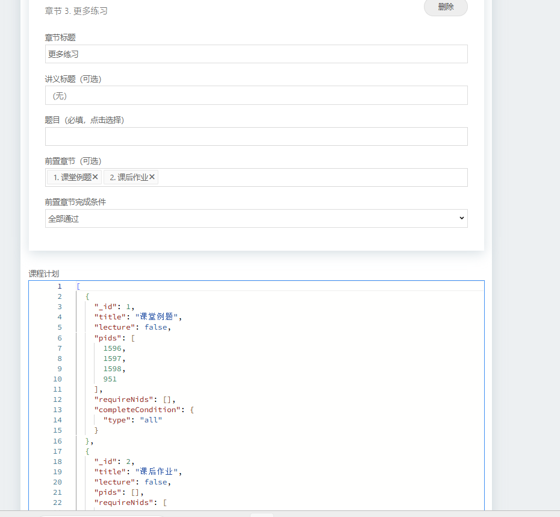**

1. 在课程创建/编辑页面的【课程计划】区域
2. 可以直接编辑DAG JSON，或使用可视化编辑器
3. 常见问题：
   - 章节ID必须唯一
   - 所有题目ID必须存在
   - 前置条件中的章节ID必须已定义
   - 不能有循环依赖

---

## 讲义管理

### 5.1 编辑章节讲义

**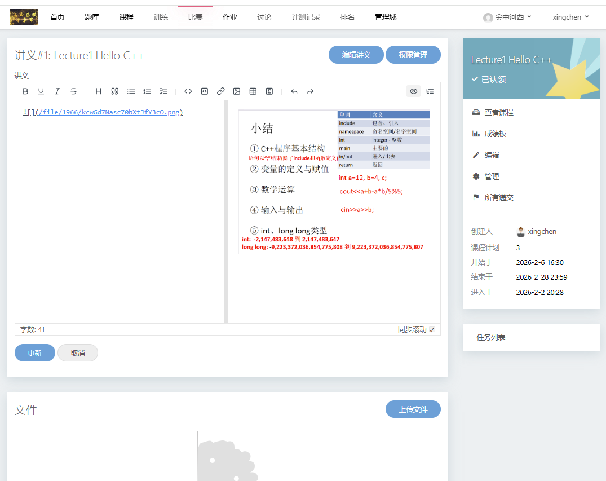**

1. 进入课程详情页
2. 找到需要编辑讲义的章节
3. 点击章节标题旁的【讲义】链接
4. 在编辑器中编写讲义内容（支持Markdown）
5. 可以上传相关文件（图片、PDF等）
6. 点击【保存】

### 5.2 上传课程文件

1. 进入讲义编辑页面
2. 在文件管理区域点击【上传文件】
3. 选择要上传的文件
4. 等待上传完成
5. 上传的文件可以在讲义中引用

**文件限制**：
- 单个文件大小限制
- 总文件数量限制
- 具体限制由系统管理员配置

### 5.3 删除文件

1. 在讲义编辑页面的文件列表中
2. 找到要删除的文件
3. 点击【删除】按钮
4. 确认删除

---

## 成绩管理

### 6.1 查看课程成绩板

**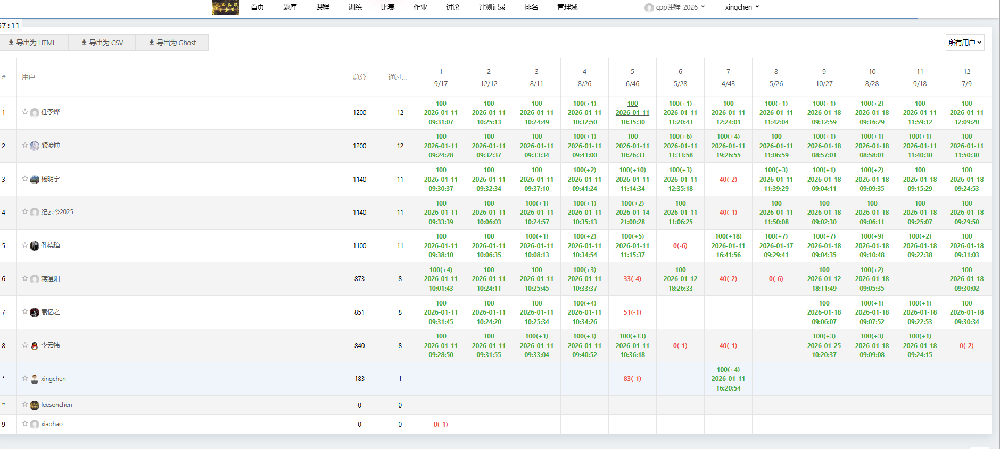**

1. 进入课程详情页
2. 点击【成绩板】标签(与作业或比赛的成绩板类似)
3. 可以看到：
   - 所有学生的成绩列表
   - 每个章节的得分
   - 题目完成情况

### 6.2 管理学生权限

**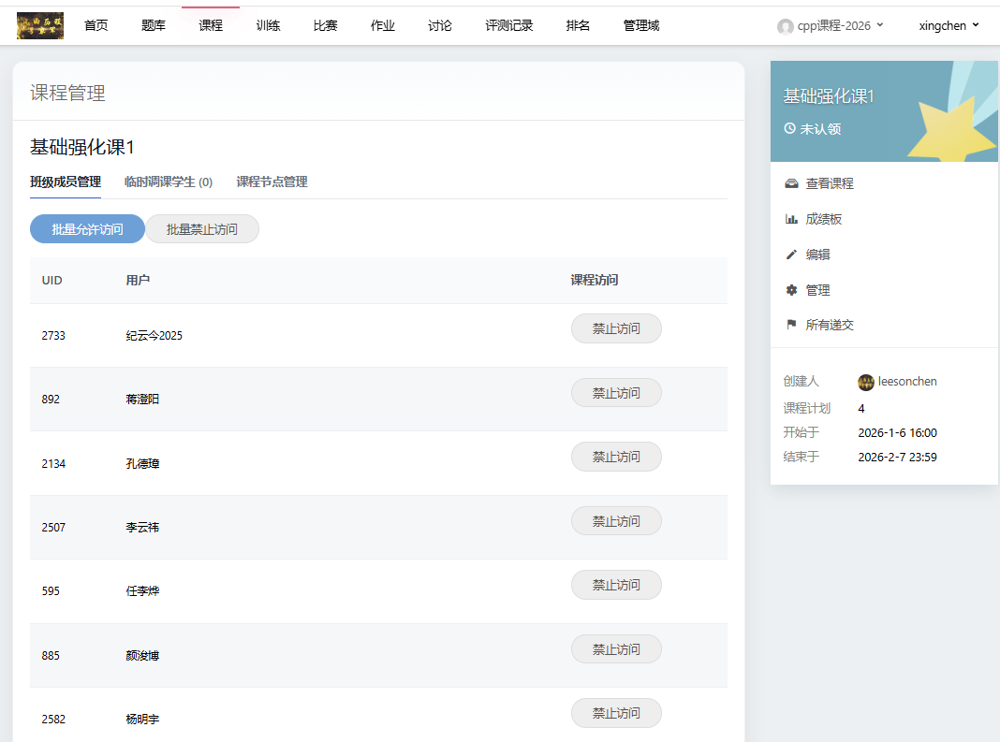**
**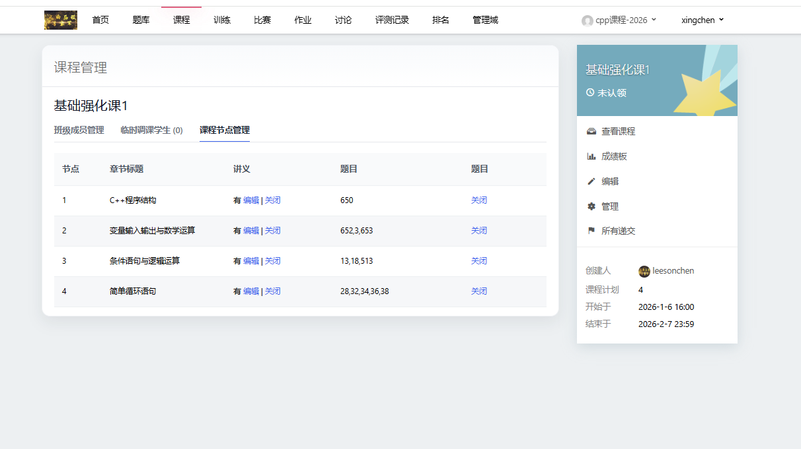**

1. 进入课程详情页
2. 点击【管理】按钮
3. 在学生列表可以进行【批量允许】或【批量禁止】
4. 在【课程节点管理】中可以手动进行特定章节/讲义的访问控制


---

## 常见问题

### Q1: 学生看不到课程怎么办？

**检查清单**：
1. 课程是否已分配给学生所在班级
2. 课程时间是否已开始
3. 学生是否已被添加到班级
4. 学生是否有查看作业权限
5. 课程是否被误删

### Q2: 学生无法访问某个章节？

**可能原因**：
1. 章节有前置条件，学生未完成前置章节
2. 教师手动禁止了该学生的章节访问
3. 课程时间未开始

**解决方法**：
1. 检查学生是否完成了前置章节
2. 在课程管理页面检查该学生的权限设置
3. 如有需要，手动为该学生开放章节权限

### Q3: 如何快速给多个班级分配相同课程？

**推荐流程**：
1. 创建课程模板
2. 在每个班级的编辑页面使用【添加课程】功能
3. 从模板复制课程到班级
4. 根据需要微调每个班级的课程时间

### Q4: 讲义中的图片无法显示？

**解决步骤**：
1. 确保图片已上传到课程文件
2. 检查图片引用路径是否正确
3. 图片格式应为JPEG/PNG/GIF等常用格式
4. 检查文件大小是否超过限制

---
