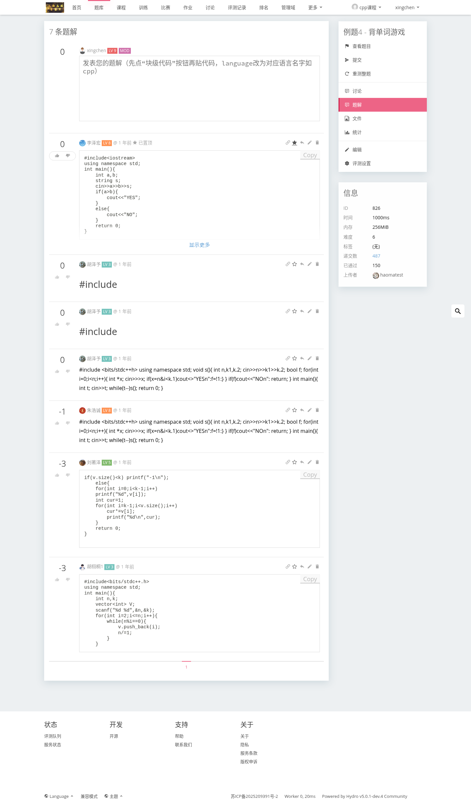
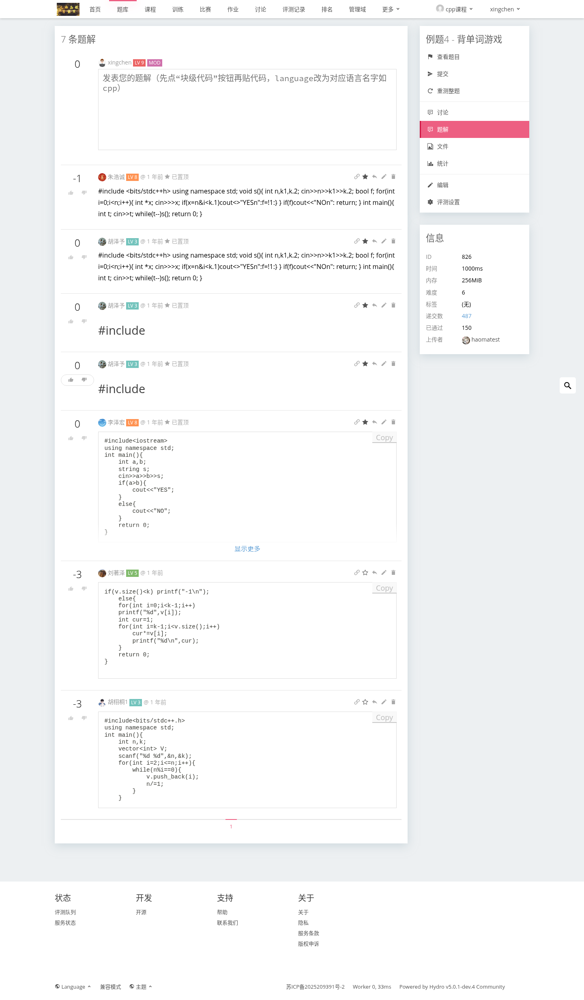
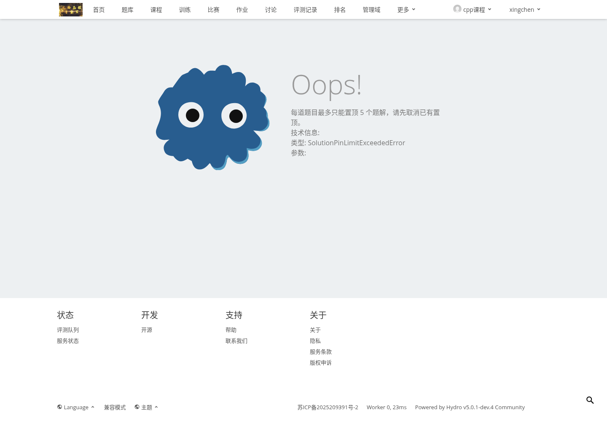
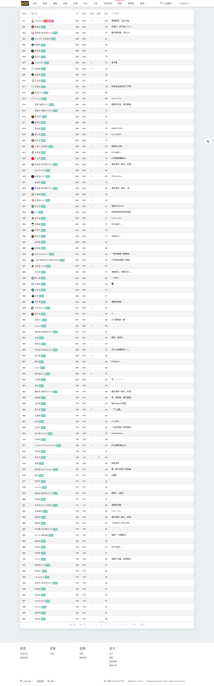
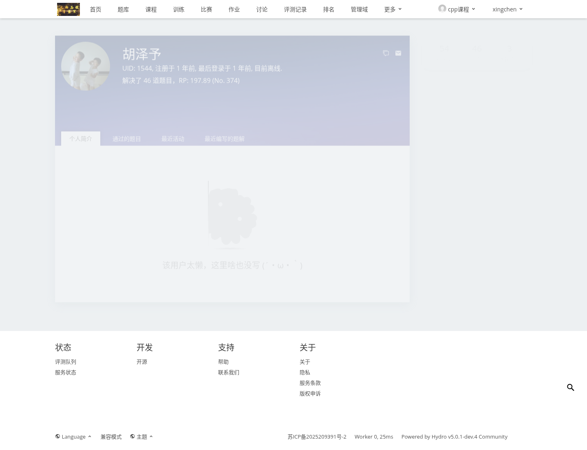

# Pinned Solution Ranking Validation Report

Date: 2026-06-09

## Scope

- Repository: `/home/leeson/Hydro`
- Branch: `course-v2.1`
- Target container: `hydro2`
- Target URL: `http://localhost:8082`
- Primary domain: `cpptrain`
- Account used: `xingchen`

## Code Commit

- `34afdcd6 feat: add pinned solution ranking score`

## Build and Publish

Commands executed:

```bash
npx tsc -p packages/hydrooj/tsconfig.json --noEmit
git diff --check
./build-and-publish-dev.sh --packages hydrooj,ui-default
```

Final published versions:

- `hydrooj@5.0.1-dev.4`
- `@hydrooj/ui-default@4.58.1-dev.6`

Build notes:

- TypeScript check passed.
- UI build passed.
- Sentry source-map upload warnings appeared because no Sentry auth token was configured; they did not block the build.

## Docker Update

Command executed in `hydro2`:

```bash
SERVICE_VERIFY_DELAY_SECONDS=5 LOGIN_VERIFY_TIMEOUT_SECONDS=120 /tmp/install-dev-from-private-npm.sh update --packages hydrooj,ui-default
```

Installed release:

- Release path: `/root/.hydro/dev-releases/20260609092019`
- Rollback backup: `/root/.hydro/dev-backups/20260609092017`
- Rollback command: `/tmp/install-dev-from-private-npm.sh rollback 20260609092017`

Service status:

- `pm2 status` showed `hydrooj`, `mongodb`, `caddy`, and `hydro-sandbox` online.
- Login page responded normally with `Hydro v5.0.1-dev.4`.

## Browser Validation

### Pinned Solution Action

Account: `xingchen`

URL: `http://localhost:8082/d/cpptrain/p/L35E4/solution`

Observed:

- The solution list showed pin buttons for a user with delete-solution permission.
- Clicking a pin button moved the solution into pinned state.
- The pinned item showed the star icon and `已置顶` label.

Screenshot:



### Per-Problem Pin Limit

Account: `xingchen`

URL: `http://localhost:8082/d/cpptrain/p/L35E4/solution`

Observed:

- Five solutions on the same problem were pinned successfully.
- Attempting to pin a sixth solution returned the expected limit error.
- Error text: `每道题目最多只能置顶 5 个题解，请先取消已有置顶。`

Screenshots:





### Ranking Solution Score

Command executed:

```bash
hydrooj cli script rp '{"domainId":"cpptrain"}'
```

Observed:

- Ranking table includes the new `题解` column.
- User `胡泽予` / uid `1544` has 3 pinned solutions.
- `rpInfo.solution` is `6`, matching `min(3 * 2, 50)`.
- Ranking row observed: `373  胡泽予  ...  题解=6`.

Screenshot:



### User Detail Pinned Count

Account: `xingchen`

URL: `http://localhost:8082/d/cpptrain/user/1544`

Observed:

- The old liked-solutions stat is now displayed as `题解置顶`.
- The count is `3`, matching uid `1544`'s pinned solution count.

Screenshots:




## Raw Browser Assertions

- Pin flow result: `reports/pinned-solution-ranking-20260609/browser-pin-result.json`
- Ranking/user result: `reports/pinned-solution-ranking-20260609/browser-ranking-result.json`

Browser notes:

- The sixth pin attempt produced the expected `403 Forbidden` error page.
- Console warnings of `Timer 'commentsPage: afterLoading' already exists` were present during repeated comment-list reloads.
- Some external avatar/CDN requests were aborted during headless page teardown; no unexpected application failure was observed.

## Test Data State

- Test problem: `cpptrain` / `L35E4`
- Five pinned solutions were left in place in the `hydro2` test environment so the screenshots and ranking/user pages can be revisited.
- Distribution after validation:
  - uid `1544`: 3 pinned solutions, ranking `题解` score `6`
  - uid `1484`: 1 pinned solution, ranking `题解` score `2`
  - uid `944`: 1 pinned solution, ranking `题解` score `2`

## Untracked Files

- `.devin/` and `testuser.md` were not modified or committed.
