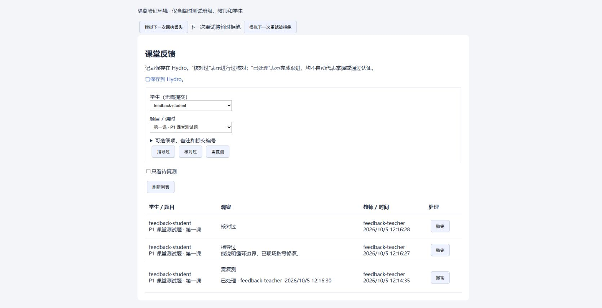

# Hydro 本地课堂反馈：实现与验证记录

日期：2026-10-05。分支：`work/hydro-local-feedback-20261005`。PR #11 保持 Draft。
H0 对照提交：`46e626892f7d061fcd490f9721b30feaf6f96c7f`；目标分支：`course-v2.2`。

## 已实现

- 独立 `classroom.feedback.events` 集合，以稳定 `_id` 的 MongoDB 唯一约束防重复，使用 majority 写确认。事实、撤销和复测处理均追加保存。
- Hydro 会话、真实域／活动、授课关系、当前名单、题目／课时及可选提交授权。`SELF` 不是全域权限；代入模式、匿名、学生及无关教师拒绝访问。每次重试重新授权。
- 同源 JSON 接口、服务端限流、禁止缓存、分页查询、待复测、教师与时间展示。查询不返回请求摘要或请求键，用户名称按页批量获取。
- 三个快捷动作；细项、500 字以内备注和提交均可空。已有课程管理内嵌入口，课程详情／提交页入口仅对授权教师展示。无提交学生可以选择。
- 网络或回执故障时保留同一操作和请求键；确认成功后刷新失败仍显示已保存。已发生状态不明的操作，即使随后重试被拒绝，也保留原键供继续核实。
- 功能开关 `classroomFeedback` 默认为 false，由 Hydro 域设置启用；关闭不删除事件。课程另需已有 `enableCourse` 开关。

记录不推导掌握度；“已处理”不自动表示复测通过。生产代码写入只进入新集合，不修改原提交、成绩、RP、Rating 或比赛难度，不建立 AI-EDU 消费／同步链路。

## 自动化实测

分母口径：完整测试脚本共 13 组 TAP 输出，合计 198 个测试；其中 App 组 51 个测试包含反馈集成的 17 个，H0 核心 49 个在另一组。以下数字有重叠，不相加。

| 检查 | 实测结果 |
| --- | --- |
| `yarn test:classroom-feedback` | 49 通过，0 失败 |
| `yarn test --port=8888 --host=127.0.0.1` | 198 通过，0 失败；App 组 51/51 |
| 真实 MongoDB／HTTP 反馈集成 | 17 通过，0 失败；已接入完整 `test`，也有独立入口 |
| 反馈核心及新增 6 个 TS/TSX 文件 lint | 0 错误，0 警告 |
| `git diff --check` | 通过 |
| 班级规模分页 | 110 条复测观察、55 条处理；剩余 55 条以 50＋5 分页，无重复；查询计划使用 `feedback_activity`，无 COLLSCAN |
| 同一请求的并发写入 | 12 个并发 HTTP 请求得到同一事件，仅新增 1 条；不同内容返回 409，新操作可并存 |
| 外部服务不可达 | 阻断所有非 loopback 的服务连接后，录入、查询、撤销和复测处理均通过，出站连接尝试 0 |
| BSON 恢复 | 新集合恢复后事实、处理／撤销、日期、分页及原请求键重放与原集合一致 |

集成还覆盖：跨域与跨活动、伪造身份／路由参数、提交关系、多课时歧义、学生调班／节点变更后的历史查询、旧请求重新授权、开关、JSON／同源约束、代入模式、长度、强制限流、真实插入故障及提交后回执丢失。历史事实可以由当前授课教师管理；新观察始终使用当前名单。撤销限原教师或域管理者。

测试使用临时配置、临时主目录和临时 MongoDB；不加载工作站正式 addon/config。原完整测试在 8888 以外端口会因已有用例的固定 Origin 失败，按预期端口重跑已通过。

## 容器实测与记忆

用户确认的本地运行环境已保存到 Codex 持久记忆。只读核对：WSL `Ubuntu-22.04`，Docker `hydro`，镜像 `hydro-leeson:v1.0`，HTTP 宿主端口 `8082`；Hydro、MongoDB、Caddy 均 online，网页返回 200。

容器工具需通过 `docker exec hydro bash -lc` 加载，Node `22.16.0`；Node、pm2、mongodump 位于 `/root/.nix-profile/bin/`。
容器挂载 `/home/leeson/docker/hydro-data → /data-host`、`hydro-logs → /var/log/hydro`，不是 Windows 源码目录。

`test/classroom-feedback-container-backup.js` 在容器内启动第二个 loopback 临时 MongoDB，仅导入浏览器验证环境的合成事件，然后实际执行 `mongodump --archive --gzip` 和 `mongorestore --nsFrom/--nsTo`：

- 4 个事件（3 条观察＋1 条处理）、4 个唯一请求键；备份 1293 字节。
- 恢复文档逐字段相等，日期类型及 `feedback_target` 索引保留。
- 测试结束关闭临时 MongoDB、删除临时目录；正式 Hydro 数据不作备份恢复或清理操作。

普通部署备份需覆盖整个 Hydro 数据库，新集合不能被排除。原备份流程仅排除 opcount/event/oplog，未排除此集合。真实机构的备份留存与灾难恢复演练仍属于部署后验收。

## 浏览器实测范围

`test/classroom-feedback-browser.js` 构建真实反馈组件，使用真实 Hydro Handler 和临时数据库。它仅绑定本机地址，有显著隔离环境标识，故障开关和固定测试身份只存在于测试脚本。

已验证无提交学生的三个按钮、默认可空细项、备注显示、回执丢失后的同键重试、待复测筛选、处理后移出待办。输入含 `<script>` 的备注按文本显示，表格中 script 节点数为 0。第一次回执丢失后数据库已有 3 条观察，重试后仍为 3 条，复测观察仅 1 条。

最终版本另验“提交后回执丢失 → 原操作重试被临时拒绝（403）→ 原键再重试成功”：只有 1 条复测事件、1 个请求键。501 字备注在页面明确拒绝；随后正常录入指导／核对并处理复测，数据库为 3 条观察＋1 条处理、4 个唯一键。截图仅为隔离组件页面，非完整默认 UI：

原生撤销确认框使浏览器控制通道失去响应，用户关闭后确认取消路径未写入撤销。撤销确认写入及重试已由真实 HTTP 测试覆盖；浏览器“确认撤销”路径仍待人工验收。
完整默认 UI 构建失败，因此组件环境不能视为完整课程管理页／原页布局端到端通过。

## 既有门禁失败及对照

当前源代码与 H0 对照使用同一套已安装依赖；基线使用独立本地工作树及独立 workspace 链接，避免加载本次 Hydro 源码。

| 门禁 | 当前 | H0 对照 | 原因 |
| --- | --- | --- | --- |
| `yarn build` / TypeScript 6.0.3 | 4 错误 | 相同 4 错误 | `ProblemConfigEditor.tsx` 123、152（两处）、153 行，`DumpOptions` 不含 `noArrayIndent` |
| `yarn build:ui` | 37 错误、1 警告 | 相同 37 错误、1 警告 | Monaco TypeScript 类型加载将 `@types/node` 内 `undici-types/*.d.ts` 当作运行模块 |
| `yarn lint:ci` | 113 错误、127 警告 | 113 错误、127 警告 | 全库已有问题；按相对文件、规则、级别、消息比较 240 条诊断，忽略因插入 import 导致的消息行号移动后，差异 0 |

仓库没有提交 `yarn.lock`。本轮安装生成的本地锁文件只用于验证，未提交、未修改依赖声明或稳定版本。环境为 Yarn `4.14.1`、Windows Node `22.20.0`、TypeScript `6.0.3`、MongoDB 测试二进制 `8.2.1`。
本地锁文件 SHA256：`A017CC0CBDF53F84B9688C6D954B77204BED5ACC14AEADE8C19201F631D17CB1`。后续应在项目认可的锁定依赖环境复核门禁。

## 剩余验收与试点步骤

H1 完成；H2 代码完成、组件验证完成；H3 本地加固与隔离验证完成，上线验收部分完成，保持 Draft。

1. 解决或正式确认既有类型／UI／lint 门禁，并用完整默认界面验证课程管理和提交预填，以及浏览器撤销确认路径。
2. 获准部署后，按仓库指定私有 registry 脚本更新目标本地容器；本轮未发布、未更新运行包、未部署、未重启服务或 Docker。
3. 对一个测试班开启域开关：原教师、同班教师、管理员与学生分别核对入口及权限；包含无提交与临时调课学生。
4. 课上记录三类观察，核对保存回执、列表、撤销和复测处理；模拟网络故障与同键重试，确认不重复；确认学生端及公开成绩不展示教师备注。
5. 开关关闭后核对做题／提交／评测／成绩；再次开启核对历史仍在。验证实际机构备份恢复后请求键及追加纠错保留。

真实班级试点尚未执行。材料可得条件尚未开发，按原定“核心闭环之后”顺序接入；AI-EDU 消费和线上 IDE 轨迹另立任务。
